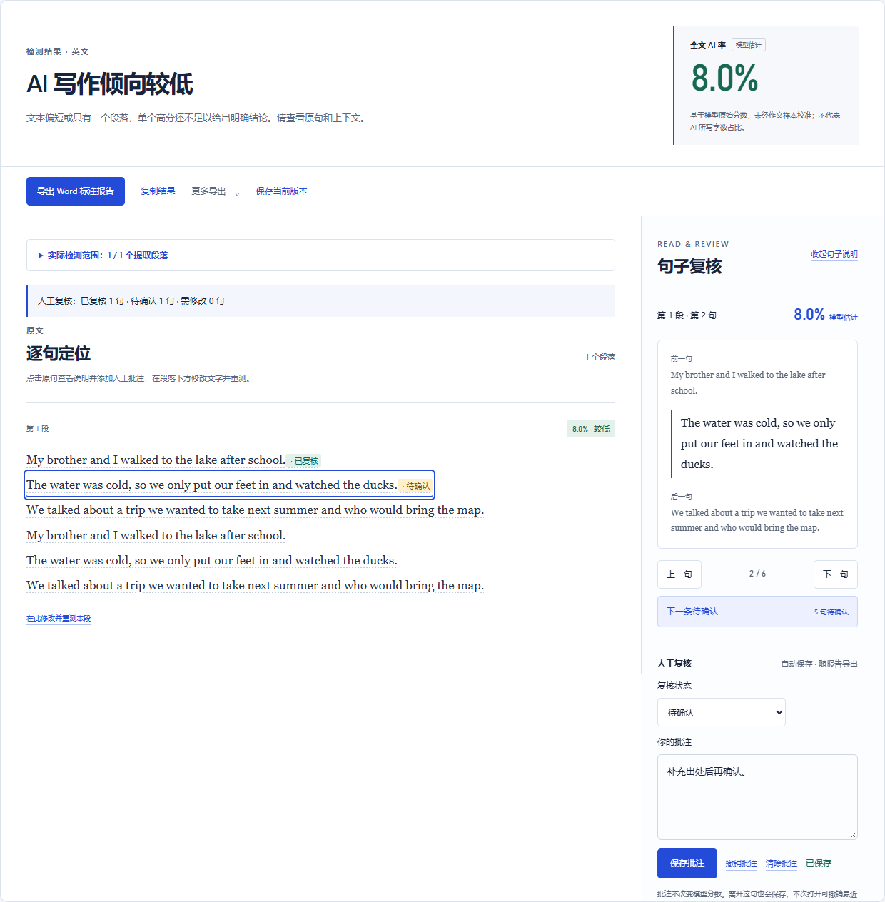
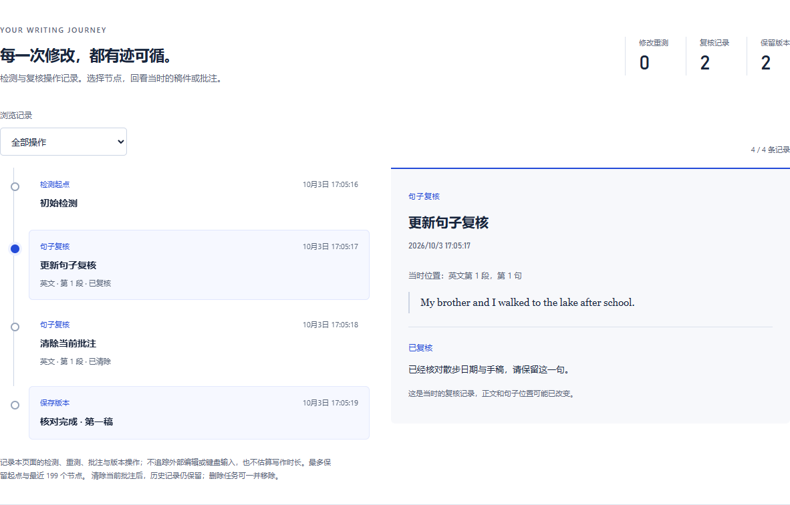
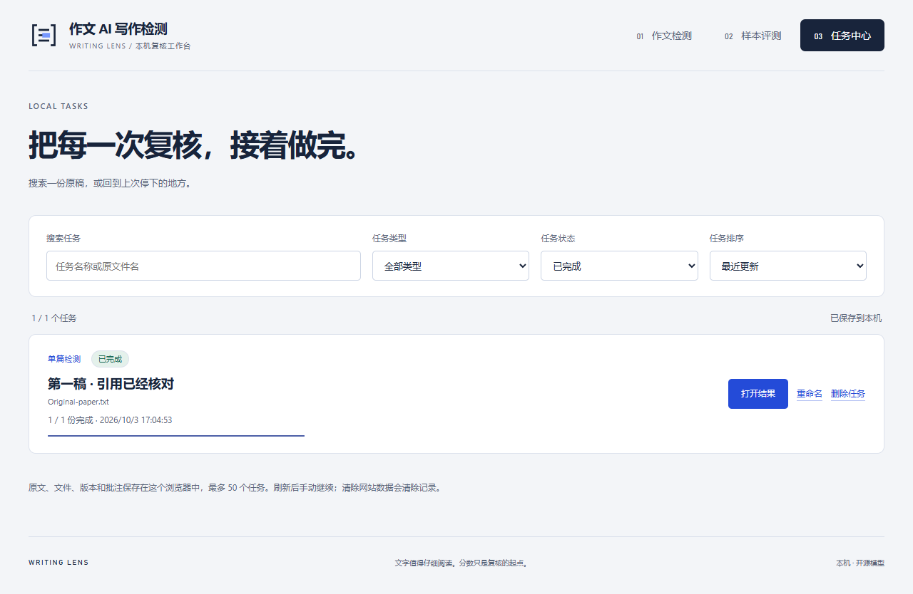
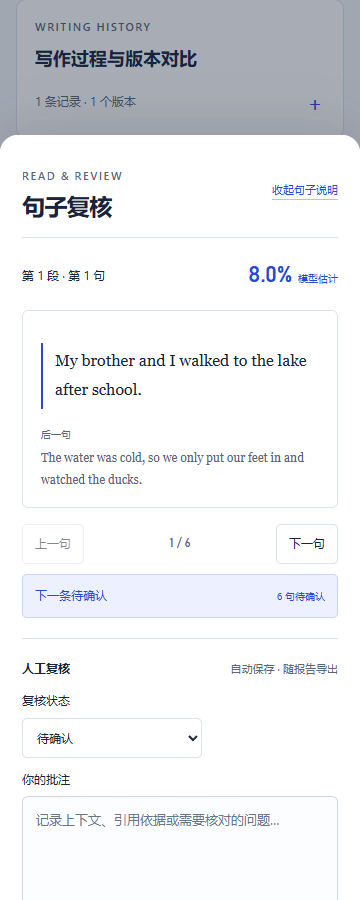

<div align="center">
  
  <h1>Essay AI Detector</h1>
  <p>A local preview for examining model signals in English and Chinese writing.</p>
  <p><strong>Local preview · Not deployed · Scores are not calibrated</strong></p>
  <p><a href="../README.md">简体中文</a> · <a href="#get-started">Get started</a> · <a href="benchmark.md">Evaluation notes</a> · <a href="../CHANGELOG.md">Changelog</a></p>
</div>



> Screenshots come from browser workflow tests using fictional text and a deterministic test model. Scores illustrate the interface, not real model performance, measured accuracy, or known authorship labels.

<details>
<summary>Writing timeline, task center and mobile review</summary>







</details>

## What it does

This work-in-progress site runs locally. Paste text or upload a `.txt`, `.docx`, or text-based PDF to preview extracted content and examine an English or Chinese model signal. Mixed-language documents can be scored by language. The results include paragraph and sentence highlights, a document overview, passages to review, and exports to HTML, JSON, and CSV. Select several files at once to score them one by one into a summary table. Inference runs on your machine; essay text is not sent to a third-party scoring API.

Batch runs retain completed results and local paragraph edits. Retry one failed file or all failures, cancel remaining files and continue later, and filter/sort the summary. Each file gets an automatic English, Chinese or bilingual language hint; unfinished files also allow a manual language choice. The 20-file limit rejects an oversized selection with a clear message instead of dropping files.

The **Sample evaluation** panel imports prediction reports or runs labelled local files from a JSONL manifest. Filter by language, source, length, writer group and split, and inspect errors alongside uncertainty and Wilson intervals. Calibration uses disjoint groups; viewing, fitting or exporting a candidate does not activate it. See the [panel guide](evaluation-panel.md).

Export an editable **Word annotation report** for one language or both. It preserves the current result text, scored sentence colours, paragraph scores, ignored text and model/calibration notes. Pending or unmatched sentence scoring is disclosed; original file layout, images and footnotes are not reproduced. Downloads follow browser settings.

Click a scored sentence to review it alongside its context in a sticky sidebar, or a bottom drawer on mobile. Notes autosave, support undo, and can be marked reviewed, pending or needing revision. Word exports include native comments and a review log; HTML and JSON retain the reviews. Rechecking changed text clears its old annotations. Single-file previews allow paragraph selection, with body and abstract shortcuts. The server verifies the original file fingerprint and reports the selected and excluded text.

Paragraph rechecks automatically create version records; you can also save named snapshots. Compare text additions, deletions and paragraph scores, with separate English and Chinese views. Restoring a snapshot keeps the previous result in history without rerunning inference. Each result retains its initial version and the most recent 19 records. Word exports the current result; JSON includes version history.

The **Writing process timeline** records actual detection, paragraph rechecks, annotation changes, saved versions and restores. Filter events, inspect historical notes, or open a snapshot comparison. Consecutive edits to the same annotation state within 60 seconds are grouped into one node. Older version records are imported with their original save timestamps and labeled as historical. The timeline retains its starting point and the latest 199 nodes; snapshots have a separate 20-version limit. It does not track external editing, keystrokes or writing duration. Clearing a current annotation retains its historical timeline entry; deleting the task removes both. JSON includes the timeline; Word, HTML and CSV export only the current result.

The **Task center** stores up to 50 detection, batch and evaluation jobs in this browser's IndexedDB, including input text, original files, results, versions and notes. Search names or original filenames, combine type and status filters, sort jobs, and rename them. Refreshing interrupts the queue; reopen a task and manually continue its unfinished items. Completed predictions are retained. Tasks can be deleted individually; clearing site data also removes them. Storage is specific to the browser and site address. See the [usage guide](review-tasks-scope.md).

## How to interpret a result

The output is a **writing-pattern signal**, not the percentage of words written by AI, evidence of misconduct, or a prediction of a school's decision. Display thresholds are provisional. The project does not yet have a representative, labeled evaluation set from which it could publish an accuracy or false-positive rate. Short texts, non-native English writing, edited text, and new domains need careful human review. See the [evaluation notes](benchmark.md).

The reproducible [public HC3 pilot](benchmark-dataset.md) uses pinned bilingual human/ChatGPT Q&A pairs, not student essays. Evaluation runs the actual local API and reports errors, uncertainty, source groups and Wilson intervals. Threshold fitting uses only calibration groups, with disjoint test groups; unverified training overlap, insufficient samples or failed test constraints keep a profile inactive. Scores remain raw model signals, and paragraph/sentence thresholds are not calibrated by document-level data.

## Get started

Use Windows, Python 3.11+, and Node.js 20.19+. Run from the repository root in PowerShell:

```powershell
py -3 -m venv .venv-detector
.\.venv-detector\Scripts\python.exe -m pip install -r backend\requirements.txt
npm --prefix frontend ci
.\.venv-detector\Scripts\python.exe experiments\download_model.py
.\打开.bat
```

Open [http://127.0.0.1:5173](http://127.0.0.1:5173) and wait for the English-ready indicator. The Chinese model downloads on first use. Run `停止.bat` when finished. Model weights, virtual environments, private essays, and local evaluation outputs are excluded from this repository.

For development and tests, see [local-development.md](local-development.md). The service is **not deployed online**. Account, usage-limit, and payment features are not implemented.

## License

The project's source code is released under the [MIT License](../LICENSE). The license covers this repository's code only: the model weights (English Vanguard, Chinese zhv3) are not included and each has its own license on its model page. Check those terms separately before any commercial or hosted use. Open-sourcing the code does not change the limits on how to read the scores.
